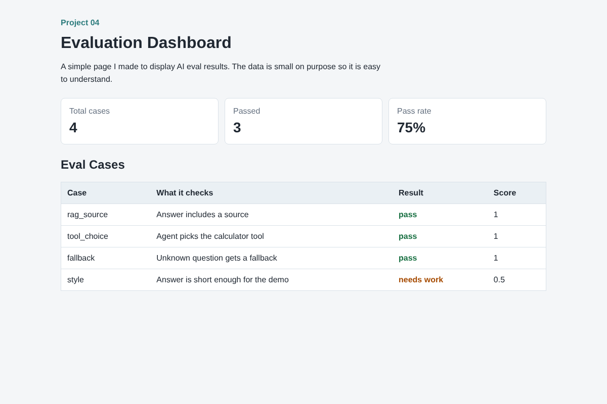

# Evaluation Dashboard

This is a static dashboard for showing AI evaluation results.

I built it because projects should not only show answers. They should also show how the answers are checked.



## What It Shows

- total eval cases
- passed cases
- pass rate
- a table with each check
- pass / needs work labels

  
## Tech Used

- HTML
- CSS
- JavaScript

## Project Files

```text
index.html      Main page
style.css       Styling
script.js       Eval data and table rendering
README.md       Project notes
```

## How To Run

Open this file in a browser:

```text
index.html
```

Or run a small local server:

```bash
python -m http.server 8080
```

Then open:

```text
http://localhost:8080
```

## What The Eval Rows Mean

| Case | Meaning |
| --- | --- |
| `rag_source` | Checks if the answer includes a source |
| `tool_choice` | Checks if the agent picks the right tool |
| `fallback` | Checks unknown questions |
| `style` | Checks if the answer is short enough |

## What I Learned

This project helped me practice displaying evaluation results in a clear way. It also made me think about how to measure AI behavior instead of only building demos.

## Future Improvements

- Load eval data from a JSON file
- Add filters for pass/fail
- Add charts
- Connect it to a backend
- Save historical eval runs
